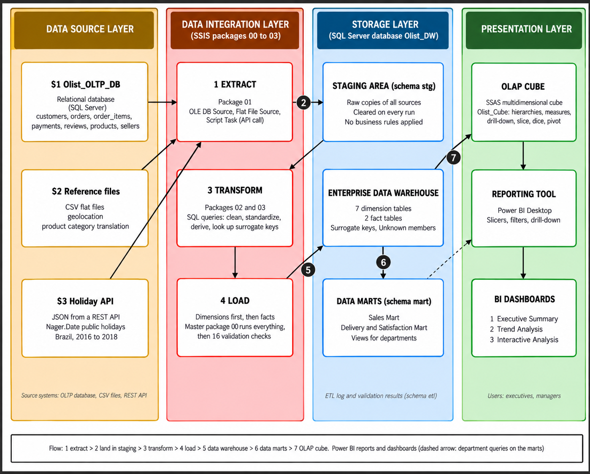
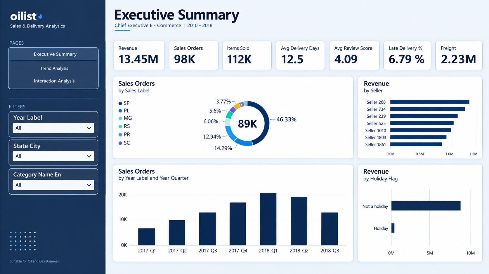
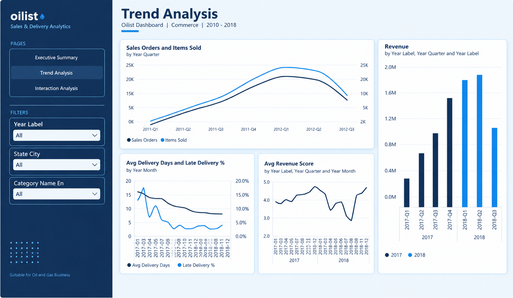
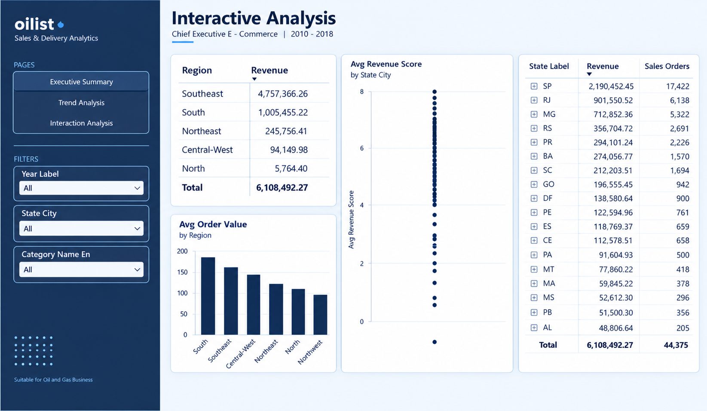

# Olist E-Commerce Data Warehouse & BI

An end-to-end data warehousing and business intelligence solution built on the
[Olist Brazilian E-Commerce dataset](https://www.kaggle.com/datasets/olistbr/brazilian-ecommerce)
(about 100k orders, September 2016 – October 2018), using the Microsoft BI stack.
Built for the IT3101 Data Warehousing and Business Intelligence module at SLIIT (group 2026-DS-02).



## Tech stack

- **SQL Server**: operational source database, staging area, data warehouse and data marts
- **SSIS**: ETL. A master package runs extract, load dimensions and load facts, then 16 validation checks.
- **SSAS**: multidimensional OLAP cube with user hierarchies and two measure groups
- **Power BI**: three-page report connected live to the cube

## Data sources

| Source | Type | Used for |
|---|---|---|
| S1 `Olist_OLTP_DB` | SQL Server database (7 tables) | Customers, orders, items, payments, reviews, products, sellers |
| S2 Reference files | CSV | Geolocation (zip → lat/long), product category translation |
| S3 [Nager.Date](https://date.nager.at/) API | JSON over HTTPS | Brazilian public holidays 2016–2018 |

## Data model

One database, `Olist_DW`, with four schemas: `stg` (staging), `dw` (warehouse), `mart` (data marts) and `etl` (logging).

The warehouse is a **fact constellation** with two fact tables sharing conformed dimensions:

| Fact table | Grain | Measures |
|---|---|---|
| `dw.Fact_Sales` | one row per order item | quantity, price, freight_value, item_total_value |
| `dw.Fact_OrderFulfilment` | one row per order | item_count, payment_total, payment_installments, delivery_days, delivery_delay_days, is_late_delivery, review_score |

Dimensions: `Dim_Date`, `Dim_Customer`, `Dim_Product`, `Dim_Seller`, `Dim_Location`, `Dim_OrderStatus`, `Dim_PaymentType`.

Some dimensions play more than one role:
- `Dim_Location` is used as both customer location and seller location.
- `Dim_Date` is used as the purchase, delivered and estimated delivery date.

### Data marts (views in schema `mart`)

| Mart | Grain | Users | Rule |
|---|---|---|---|
| `mart.Sales_Mart` | order item | Sales & marketing | Only real sales (canceled / unavailable removed) |
| `mart.Delivery_Satisfaction_Mart` | order | Operations & customer service | Only delivered orders |

## Dashboards

### Executive Summary


### Trend Analysis


### Interactive Analysis


## Repository structure

```
sql/              T-SQL scripts, numbered in run order (+ optional profiling queries)
ssis/Olist_ETL/   SSIS project: 00_Master, 01_Staging_Load, 02_Load_Dimensions, 03_Load_Facts
ssas/             SSAS project: Olist DW Cube, data source view, 7 dimensions
powerbi/          Power BI report (Olist_Dashboard.pbix) and its page backgrounds
images/           Architecture diagram and dashboard screenshots
docs/             Final report and presentation
data/             Dataset download instructions and the saved holiday JSON files
```

## How to run

**1. Prepare the files** (see [data/README.md](data/README.md)):
- Download the 9 Olist CSV files into `C:\DWBI_Project\Source_CSV\`.
- Copy `data/holidays/*.json` into `C:\DWBI_Project\Holiday_JSON\`. These are a fallback if the API can't be reached.

**2. Run the SQL scripts in SSMS, in order:**

| # | Script | What it does |
|---|---|---|
| 01 | `01_create_oltp_db.sql` | Creates the source database `Olist_OLTP_DB` (7 tables, PKs and FKs) |
| 02 | `02_load_oltp.sql` | Loads the 7 transactional CSV files with `BULK INSERT` |
| 03 | `03_create_warehouse.sql` | Creates `Olist_DW`, the 4 schemas, 7 dimensions (with Unknown members) and 2 fact tables |
| 04 | `04_create_staging.sql` | Creates the 11 staging tables for the three sources |
| 05 | `05_validation.sql` | Creates the ETL log tables and `etl.usp_run_validation` (16 checks) |
| 06 | `06_data_marts.sql` | Creates the two data mart views |
| 07 | `07_SSAS_Permissions.sql` | Gives the SSAS service account read access to `Olist_DW` |

`sql/profiling/` holds optional read-only queries used for the data profiling and quality checks in the report.

**3. Run the ETL:** open `ssis/Olist_ETL/Olist_ETL.slnx` in Visual Studio (SSIS extension) and run **`00_Master.dtsx`**.
It runs `01_Staging_Load` → `02_Load_Dimensions` → `03_Load_Facts`, then the validation procedure.

**4. Build the cube:** open `ssas/SSAS.slnx`, then deploy and process `Olist_Cube` to your SSAS server (default: `localhost`).

**5. Open the report:** open `powerbi/Olist_Dashboard.pbix`. It was built against `localhost\SSAS`. If your SSAS server has a different name, change it under **Transform data → Data source settings → Change source**.

> **Connections:** everything uses `localhost` with Windows authentication. If your SQL Server or SSAS instance
> has another name, update the two SSIS connection managers, the SSAS data source (`Olist DW.ds`) and the
> Power BI data source.

## Results

All 16 validation checks pass after each run:
- `Fact_Sales` has 112,650 rows and `Fact_OrderFulfilment` has 99,441.
- Price, freight and payment totals match the source exactly.

The full design, ETL documentation and the eight business insights are in [`docs/`](docs/).

## Dataset credit

Dataset by [Olist](https://olist.com/), published on Kaggle under CC BY-NC-SA 4.0.
Holiday data from the [Nager.Date](https://date.nager.at/) public holiday API.
